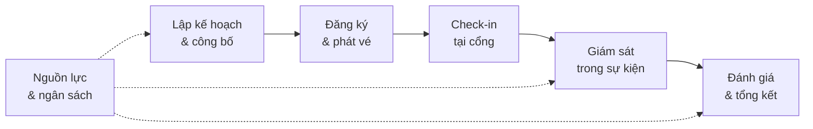
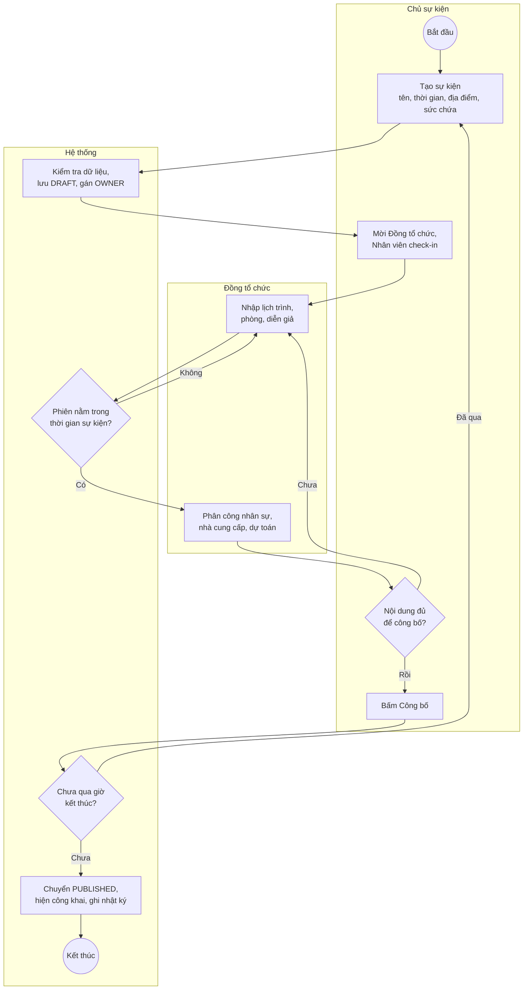
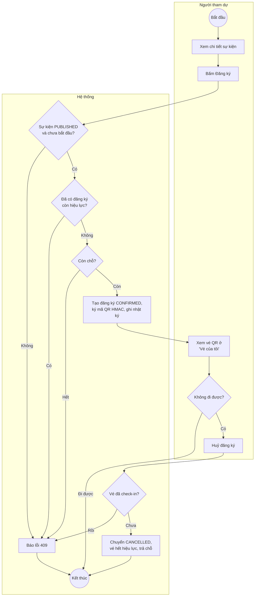
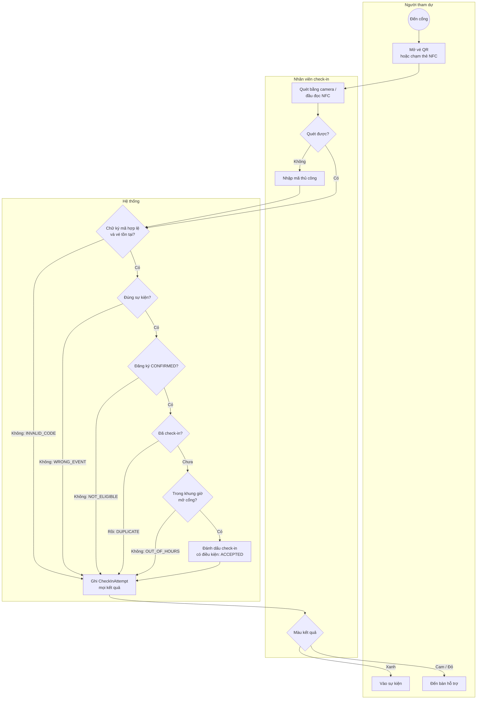
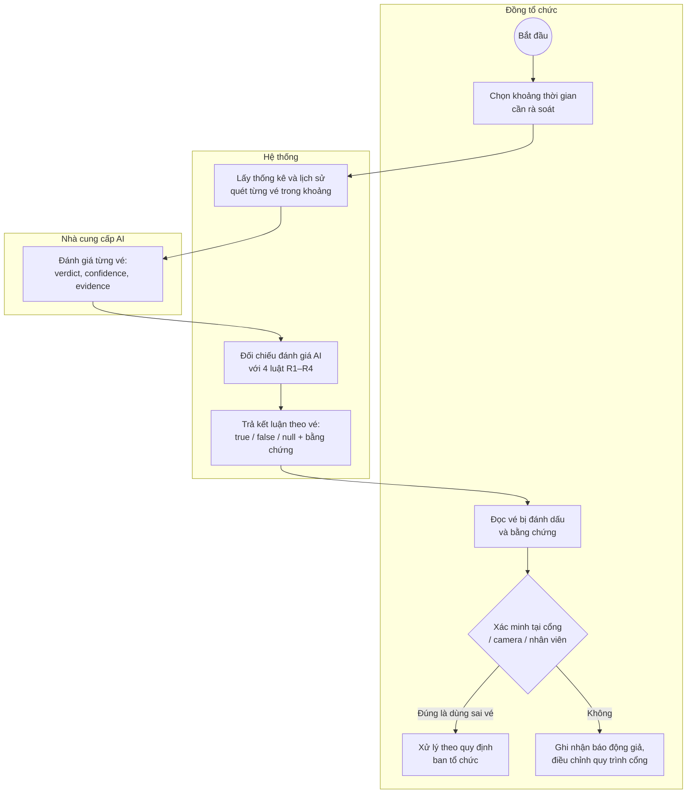
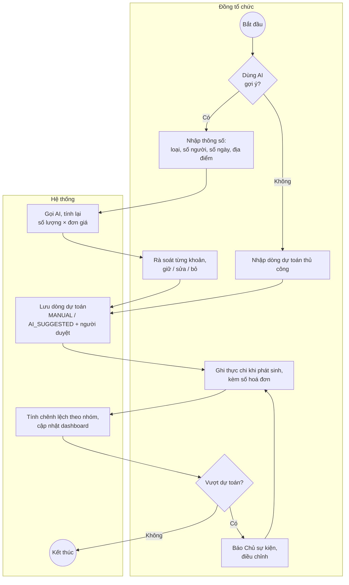
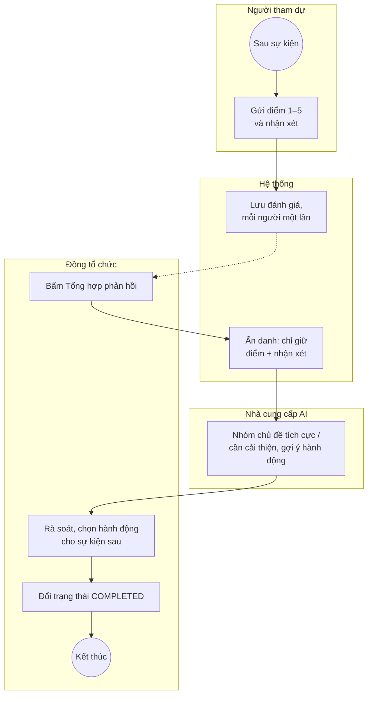
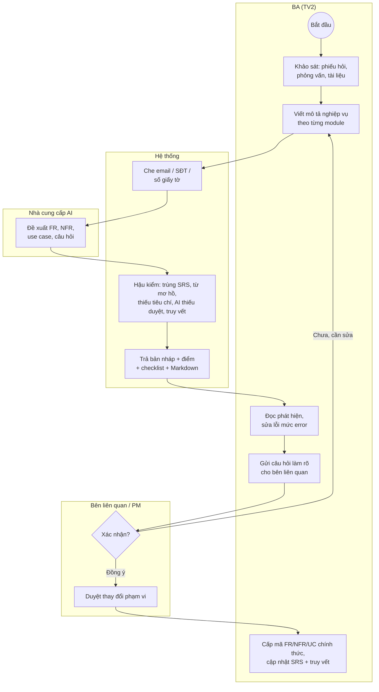

# Quy trình nghiệp vụ và sơ đồ hoạt động

> Người phụ trách: TV2 – BA. Sơ đồ hoạt động vẽ bằng Mermaid, mỗi `subgraph` là một làn (swimlane) theo tác nhân.

## 1. Hiện trạng (AS-IS) và quy trình mới (TO-BE)

| Bước | Cách làm phổ biến hiện nay (AS-IS) | Vấn đề | Quy trình mới (TO-BE) |
|---|---|---|---|
| Lập kế hoạch | Bảng tính + nhóm chat; mỗi người giữ một bản | Lệch phiên bản, không rõ ai được sửa | Sự kiện, lịch trình, ban tổ chức tập trung một nơi, phân quyền theo vai trò |
| Đăng ký | Google Form, xuất danh sách ra Excel | Đăng ký trùng, vượt sức chứa, phải lọc tay | Đăng ký trực tuyến chặn trùng và chặn vượt sức chứa tự động |
| Phát vé | Gửi email/tin nhắn danh sách hoặc mã tự đặt | Mã dễ đoán, dễ chuyển cho người khác | Vé QR có chữ ký HMAC, không giả mạo được |
| Check-in | Dò tên trên giấy/Excel ở cổng | Xếp hàng lâu, một vé dùng nhiều lần, không biết ai đã vào | Quét QR bằng điện thoại, mỗi vé chỉ chấp nhận một lần, ghi mọi lượt quét |
| Theo dõi | Hỏi qua nhóm chat | Không có số liệu thời gian thực | Dashboard: đăng ký, check-in theo khung giờ, mật độ khu vực, chi phí |
| Chi phí | Tổng hợp hoá đơn sau sự kiện | Phát hiện vượt dự toán quá muộn | Dự toán – thực chi theo từng khoản, xem chênh lệch ngay |
| Sau sự kiện | Đọc tay từng phản hồi | Tốn thời gian, khó thấy xu hướng | AI nhóm chủ đề phản hồi, ban tổ chức duyệt |

## 2. Tổng quan chuỗi giá trị

## 3. BP-01. Lập kế hoạch và công bố sự kiện (UC-04, UC-05, UC-06, UC-07)

## 4. BP-02. Đăng ký tham dự và phát vé (UC-08, UC-09)

Bước y2–y4 chạy trong một giao dịch mức Serializable để hai người không cùng lấy được chỗ cuối.

## 5. BP-03. Check-in tại cổng (UC-10)

Khung giờ check-in: từ 120 phút trước giờ bắt đầu đến giờ kết thúc. Nếu hai máy quét cùng một vé cùng lúc, chỉ một máy cập nhật được `checkedInAt`, máy kia nhận DUPLICATE.

## 6. BP-04. Rà soát bất thường check-in bằng AI (UC-17)

Hệ thống **không** tự khoá vé hay từ chối người tham dự; quyết định cuối thuộc ban tổ chức (BR-10).

## 7. BP-05. Dự toán – thực chi (UC-14)

## 8. BP-06. Sau sự kiện: đánh giá và tổng hợp (UC-12)

Bước a1–y1 thuộc FR-08, **chưa có API/giao diện**; các bước còn lại đã có.

## 9. BP-07. Quy trình phân tích yêu cầu của BA có AI hỗ trợ (UC-16)

