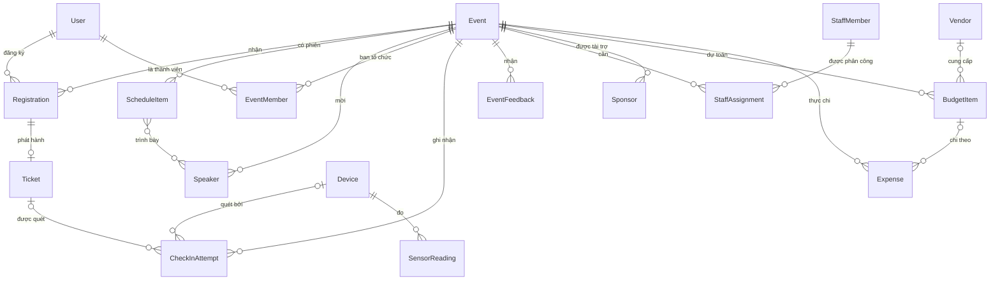
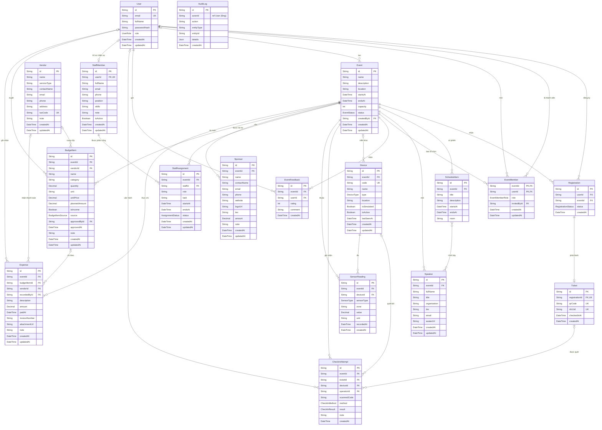
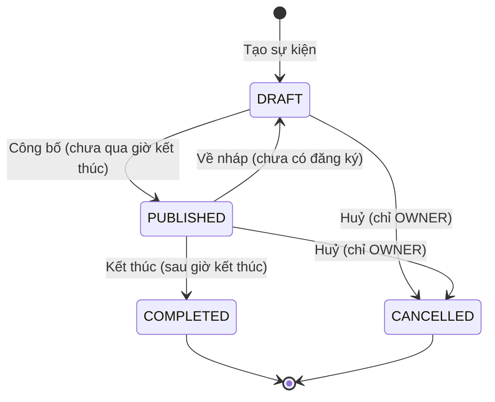

# Thiết kế cơ sở dữ liệu (ERD)

> Người phụ trách: TV2 – BA. Nguồn sự thật: `prisma/schema.prisma` (MySQL 8.4, Prisma 6); migration trong `prisma/migrations/`.
> Sơ đồ viết bằng Mermaid nên hiển thị trực tiếp trên GitHub. Khi schema đổi, cập nhật tài liệu này trong cùng pull request.

## 1. Sơ đồ tổng quan (theo nhóm nghiệp vụ)

Năm nhóm dữ liệu:

| Nhóm | Bảng | Phục vụ yêu cầu |
|---|---|---|
| Tài khoản & ban tổ chức | User, EventMember | FR-01, FR-15 |
| Sự kiện & chương trình | Event, ScheduleItem, Speaker | FR-02, FR-03 |
| Đăng ký, vé, check-in, IoT | Registration, Ticket, CheckInAttempt, Device, SensorReading | FR-04, FR-05, FR-06, FR-13, FR-17 |
| Nguồn lực & tài chính | StaffMember, StaffAssignment, Vendor, Sponsor, BudgetItem, Expense | FR-09, FR-12 |
| Phản hồi & kiểm soát | EventFeedback, AuditLog | FR-08, FR-14, FR-16 |

## 2. Sơ đồ chi tiết (đầy đủ thuộc tính)

PK = khoá chính, FK = khoá ngoại, UK = duy nhất. Kiểu enum xem mục 4.

## 3. Quan hệ và quy tắc toàn vẹn

| Quan hệ | Bản số | Xoá bản ghi cha | Ý nghĩa nghiệp vụ |
|---|---|---|---|
| User – Registration – Event | N–N qua Registration | Cascade | Một người chỉ có **một** đăng ký cho mỗi sự kiện (`@@unique([userId, eventId])`); đăng ký bị huỷ có thể kích hoạt lại. |
| Registration – Ticket | 1 – 0..1 | Cascade | Mỗi đăng ký hợp lệ có đúng một vé. `qrCode` duy nhất, dạng `SE1.<ticketId>.<HMAC>`; `nfcUid` duy nhất nếu gắn thẻ NFC. |
| Ticket – CheckInAttempt | 0..1 – N | SetNull | Ghi **mọi** lượt quét, kể cả mã sai (ticketId = null). Chỉ lượt ACCEPTED mới ghi `Ticket.checkedInAt`. |
| Device – CheckInAttempt / SensorReading | 0..1 – N / 1 – N | SetNull / Cascade | Máy quét, đầu đọc NFC, cảm biến (có cờ `isSimulated` cho demo). `Device.code` duy nhất, là mã máy gửi lên khi check-in. |
| Event – EventMember – User | N–N | Cascade | Khoá chính kép (eventId, userId): mỗi người có **một** vai trò trong một sự kiện; sự kiện luôn còn ít nhất một OWNER (kiểm tra ở service). |
| User – Event (createdBy) | 0..1 – N | SetNull | Người tạo tự trở thành OWNER. |
| ScheduleItem – Speaker | N–N | Cascade | Bảng nối ngầm `_ScheduleItemToSpeaker`; diễn giả phải cùng sự kiện với phiên. |
| StaffMember – StaffAssignment – Event | N–N | Cascade | Duy nhất theo (eventId, staffId, role). StaffMember là danh bạ dùng chung, có thể liên kết 0..1 tài khoản. |
| Event – Sponsor | 1 – N | Cascade | Gộp thông tin nhà tài trợ và giá trị tài trợ (đã bỏ bảng Funding vì trùng). |
| Event – BudgetItem – Expense | 1 – N – N | Cascade / SetNull | `plannedAmount = quantity × unitPrice` (tính ở service). Expense không gắn BudgetItem = chi phát sinh ngoài dự toán. Thiết kế: dòng `source = AI_SUGGESTED` cần người duyệt (`approvedById`, `approvedAt`) – hiện service chưa ghi hai trường này. |
| Event – EventFeedback – User | N–N | Cascade | Mỗi người đánh giá một sự kiện một lần (`@@unique([eventId, userId])`). |
| AuditLog | độc lập | – | `actorId`, `entityId` là tham chiếu lỏng (không FK) để log vẫn còn khi bản ghi gốc bị xoá. |

## 4. Kiểu liệt kê (enum) và vòng đời

| Enum | Giá trị | Ghi chú |
|---|---|---|
| UserRole | ADMIN, ORGANIZER, ATTENDEE | Quyền hệ thống; tài khoản tự đăng ký luôn là ATTENDEE. |
| EventMemberRole | OWNER, CO_ORGANIZER, CHECKIN_STAFF | Quyền trong từng sự kiện. |
| EventStatus | DRAFT, PUBLISHED, CANCELLED, COMPLETED | Xem sơ đồ trạng thái bên dưới. |
| RegistrationStatus | PENDING, CONFIRMED, CANCELLED | Hiện đăng ký tạo ra là CONFIRMED ngay (PENDING dự phòng cho duyệt thủ công). |
| CheckInMethod | QR, NFC, MANUAL | |
| CheckInResult | ACCEPTED, DUPLICATE, INVALID_CODE, WRONG_EVENT, NOT_ELIGIBLE, OUT_OF_HOURS | AI check-in quy đổi sang ACCEPTED / ALREADY_USED / INVALID / NOT_ELIGIBLE. |
| DeviceType | QR_SCANNER, NFC_READER, SENSOR, GATEWAY | |
| SensorType | TEMPERATURE, HUMIDITY, CO2, NOISE, PEOPLE_COUNT, OTHER | PEOPLE_COUNT dùng cho mật độ khu vực trên dashboard. |
| AssignmentStatus | ASSIGNED, CONFIRMED, DECLINED, COMPLETED | |
| BudgetItemSource | MANUAL, AI_SUGGESTED | |

Sự kiện CANCELLED/COMPLETED không được sửa; sức chứa mới không được nhỏ hơn số đăng ký CONFIRMED.

## 5. Chỉ mục phục vụ truy vấn chính

- `Event(status, startsAt)`: danh sách sự kiện công khai theo thời gian.
- `CheckInAttempt(eventId, createdAt)` và `(eventId, result)`: dashboard và AI phân tích check-in theo khoảng thời gian.
- `SensorReading(eventId, zone, recordedAt)`: mật độ theo khu vực.
- `Registration(eventId, status)`: đếm chỗ đã dùng khi kiểm soát sức chứa.

## 6. Hạn chế và việc còn lại

- Chưa có API ghi EventFeedback (bảng đã có) → FR-08 và AI feedback-insights (FR-14) chưa có dữ liệu thật.
- Chưa có API quản lý Device/SensorReading; dữ liệu thiết bị hiện do seed tạo.
- AuditLog đang ghi thao tác sự kiện (tạo, sửa, đổi trạng thái), lịch trình, đăng ký/huỷ và thành viên ban tổ chức; chưa ghi cho nguồn lực, dự toán – thực chi và check-in (check-in đã có bảng CheckInAttempt riêng).
