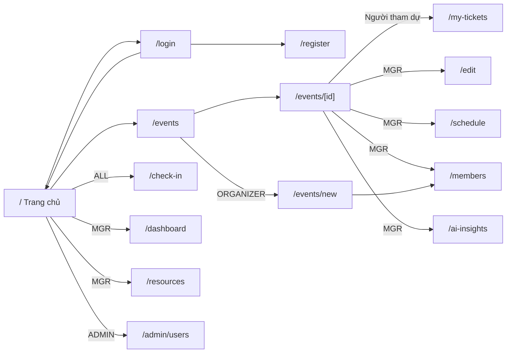

# Thiết kế giao diện

- Thiết kế tham chiếu hiện tại: [trang chủ](../../apps/web/src/app/page.tsx) và [CSS chung](../../apps/web/src/app/globals.css); chưa có Figma.
- Màn hình: đăng nhập, danh sách/chi tiết sự kiện, đăng ký, vé QR, check-in, dashboard, đánh giá và quản trị.
- Frontend khởi tạo tại `apps/web`.

## Định hướng giao diện

- Giữ giao diện sáng và màu xanh dương hiện có làm điểm nhấn; nền sáng, bề mặt trắng và chữ tối.
- Nút chính chuyển sang tông tối gần đen; nút phụ và nút nguy hiểm cần phân biệt rõ với nút chính. Dùng màu xanh cho liên kết, trạng thái đang chọn và các điểm nhấn phù hợp.
- Ưu tiên chuyển động tinh tế, mượt và nhẹ, tham khảo cảm giác tương tác của Claude: chuyển trạng thái hover/focus, mở nội dung và phản hồi thao tác; không sao chép giao diện. Không để hiệu ứng cản trở thao tác hoặc làm chậm nội dung.
- Tôn trọng thiết lập giảm chuyển động của người dùng (`prefers-reduced-motion`); vẫn đảm bảo nhận biết trạng thái khi không có animation.
- Dùng bố cục thoáng, phân cấp chữ rõ ràng, thành phần nhất quán và giao diện thích ứng với điện thoại/desktop.

Định hướng màu sắc và chuyển động đã được người yêu cầu xác nhận. Chưa có thiết kế Figma hoặc xác nhận của cả nhóm.

## Quy ước triển khai phần nền

- Màu nền `#f4f7fb`, bề mặt `#ffffff`, chữ chính `#172033`, chữ phụ `#526078`, điểm nhấn `#2563eb`, nút chính `#202734`.
- Font Aptos/Segoe UI với dự phòng sans-serif, dùng cùng một họ chữ với kích thước và độ đậm phân cấp. Trang chủ giới thiệu quy trình sự kiện và vai trò người dùng; menu hiển thị theo quyền đã có.
- Hover/focus và phản hồi thao tác dùng chuyển động ngắn, không chặn thao tác; tắt gần như hoàn toàn khi bật `prefers-reduced-motion`.
- Menu cuộn ngang trên màn hình nhỏ; phần giới thiệu và nội dung theo vai trò tự chuyển thành một cột khi cần. Bảng dữ liệu có vùng cuộn ngang riêng.
- Loading, dữ liệu rỗng và lỗi phải có nội dung rõ ràng; đổi quyền thành công có thông báo dùng kiểu chung và `role="status"`.

## Tiêu chí review

- Trang chủ và menu dẫn đến các trang thực sự có trong ứng dụng, không giả lập chức năng hoặc số liệu.
- Nội dung dễ đọc ở desktop và điện thoại; không tràn trang, trừ vùng bảng được phép cuộn ngang.
- Có thể điều hướng bằng bàn phím, nhận biết focus, nhãn form và các thông báo lỗi; kiểm tra độ tương phản chữ và nút.
- Hiệu ứng không gây khó chịu, không làm mất thông tin khi bật giảm chuyển động. Cần kiểm tra trực tiếp trên trình duyệt trước khi nghiệm thu.

---

## Phân tích giao diện (TV2 – BA)

Phần dưới bổ sung danh mục màn hình, điều hướng theo vai trò và khung (wireframe) màn hình chính, đối chiếu với `apps/web/src/app` và `apps/web/src/lib/navigation.ts`. Phần định hướng thẩm mỹ ở trên giữ nguyên.

### Danh mục màn hình

| Mã | Màn hình | Đường dẫn | Ai được vào | Use case | Trạng thái |
|---|---|---|---|---|---|
| SC-01 | Trang chủ theo vai trò (khách / người tham dự / ban tổ chức / quản trị) | `/` | Mọi người | UC-03 | Đã có |
| SC-02 | Đăng nhập | `/login` | Khách | UC-02 | Đã có |
| SC-03 | Đăng ký tài khoản | `/register` | Khách | UC-01 | Đã có |
| SC-04 | Thông tin tài khoản, đổi mật khẩu | `/account` | Đã đăng nhập | UC-02 | Đã có |
| SC-05 | Danh sách sự kiện (+ nút Tạo sự kiện cho ban tổ chức) | `/events` | Mọi người | UC-03 | Đã có |
| SC-06 | Tạo sự kiện | `/events/new` | ORGANIZER | UC-04 | Đã có |
| SC-07 | Chi tiết sự kiện: mô tả, lịch trình, diễn giả, nút Đăng ký, lối vào quản lý theo vai trò | `/events/[id]` | Mọi người | UC-03, UC-08 | Đã có |
| SC-08 | Sửa sự kiện, đổi trạng thái | `/events/[id]/edit` | MGR | UC-05 | Đã có |
| SC-09 | Lịch trình & diễn giả | `/events/[id]/schedule` | MGR | UC-06 | Đã có |
| SC-10 | Thành viên ban tổ chức | `/events/[id]/members` | ALL (sửa: OWNER) | UC-07 | Đã có |
| SC-11 | Tổng hợp phản hồi AI | `/events/[id]/ai-insights` | MGR | UC-12 | Đã có |
| SC-12 | Vé của tôi (mã QR, huỷ đăng ký) | `/my-tickets` | ATTENDEE | UC-08, UC-09 | Đã có |
| SC-13 | Check-in: camera, nhập mã, lớp phủ kết quả, bảng kiểm tra gian lận AI | `/check-in?eventId=` | ALL | UC-10, UC-17 | Đã có |
| SC-14 | Dashboard sự kiện | `/dashboard?eventId=` | MGR | UC-11 | Đã có |
| SC-15 | Nguồn lực: nhân sự & phân ca, nhà cung cấp, tài trợ, dự toán – thực chi | `/resources` | MGR | UC-13, UC-14 | Đã có |
| SC-16 | Quản lý người dùng | `/admin/users` | ADMIN | UC-18 | Đã có |
| SC-17 | Gửi đánh giá sự kiện | (đề xuất: khối trong SC-07 / SC-12 sau sự kiện) | ATTENDEE đã check-in | UC-12 | Chưa làm |
| SC-18 | Nhật ký thao tác | (đề xuất: tab trong SC-14) | MGR | UC-19 | Chưa làm |
| SC-19 | AI bản nháp yêu cầu / tóm tắt tiến độ / gợi ý dự toán | (hiện dùng Swagger `/docs`) | ORGANIZER | UC-14, UC-15, UC-16 | Chưa có giao diện |

ALL = Chủ sự kiện, Đồng tổ chức, Nhân viên check-in; MGR = Chủ sự kiện, Đồng tổ chức. ADMIN vào được mọi màn hình.

### Sơ đồ điều hướng



Menu hiển thị theo quyền: Nhân viên check-in thuần chỉ thấy mục Check-in; người tham dự thấy "Vé của tôi"; mục Dashboard/Nguồn lực chỉ hiện khi tài khoản có vai trò quản lý ở ít nhất một sự kiện.

### Wireframe màn hình chính

**SC-13 Check-in (ưu tiên điện thoại, một tay thao tác)**

```text
┌──────────────────────────────┐
│ Check-in · [Chọn sự kiện ▾]  │
│ Cổng mở 07:00 – đóng 17:00   │
├──────────────────────────────┤
│                              │
│      [ Khung camera QR ]     │
│                              │
│  ┌────────────────────────┐  │
│  │ ✔ Check-in thành công  │  │  ← lớp phủ xanh / cam (trùng,
│  │   Nguyễn Văn A         │  │     ngoài giờ) / đỏ (mã sai),
│  └────────────────────────┘  │     có biểu tượng + chữ + rung
├──────────────────────────────┤
│ Nhập mã thủ công [______][→] │
│ Hôm nay: 312 hợp lệ · 9 lỗi  │
├──────────────────────────────┤
│ ▸ Kiểm tra gian lận (AI)     │  ← chỉ MGR, chọn from/to
└──────────────────────────────┘
```

**SC-07 Chi tiết sự kiện (người tham dự)**

```text
┌──────────────────────────────────────────┐
│ ← Sự kiện   Hội thảo Công nghệ 2026      │
│ 08:00–17:00 20/12 · Hội trường A         │
│ Còn 48 / 300 chỗ        [ Đăng ký ]      │
├──────────────────────────────────────────┤
│ Mô tả …                                  │
│ Lịch trình                               │
│  08:30 Khai mạc · Phòng 1 · Diễn giả X   │
│  09:00 Phiên AI … · Phòng 2 · Diễn giả Y │
│ Diễn giả  [ảnh] Tên · Chức danh · Đơn vị │
└──────────────────────────────────────────┘
(MGR thấy thêm hàng nút: Sửa · Lịch trình · Thành viên · Dashboard · Check-in · AI)
```

**SC-14 Dashboard (desktop)**

```text
┌ Dashboard · [Sự kiện ▾] ──────────────────────────────────────┐
│ [Đã đăng ký 252/300 ▓▓▓▓░] [Đã check-in 180/252 ▓▓▓░] [Bị từ chối 14] [Thực chi 62% ▓▓▓░] │
├───────────────────────────────┬───────────────────────────────┤
│ Đăng ký theo ngày (đường)     │ Check-in theo khung giờ (cột) │
├───────────────────────────────┼───────────────────────────────┤
│ Kết quả quét (cột ngang)      │ Mật độ theo khu vực (bảng)    │
├───────────────────────────────┴───────────────────────────────┤
│ Dự toán – thực chi theo nhóm (cột đôi) + bảng dữ liệu          │
└───────────────────────────────────────────────────────────────┘
```

### Quy tắc giao diện nghiệp vụ

1. Mọi kết quả AI hiển thị nhãn "Nội dung do AI tạo – cần người phụ trách rà soát" (NFR-AI-01).
2. Kết quả check-in không chỉ dựa vào màu: luôn có biểu tượng và câu chữ (NFR-USA-02).
3. Nút thao tác không được phép bị ẩn hẳn thay vì chỉ vô hiệu hoá, để tránh người dùng thử và nhận 403.
4. Ngày giờ hiển thị theo giờ Việt Nam (UTC+7), định dạng `dd/MM/yyyy HH:mm`.
