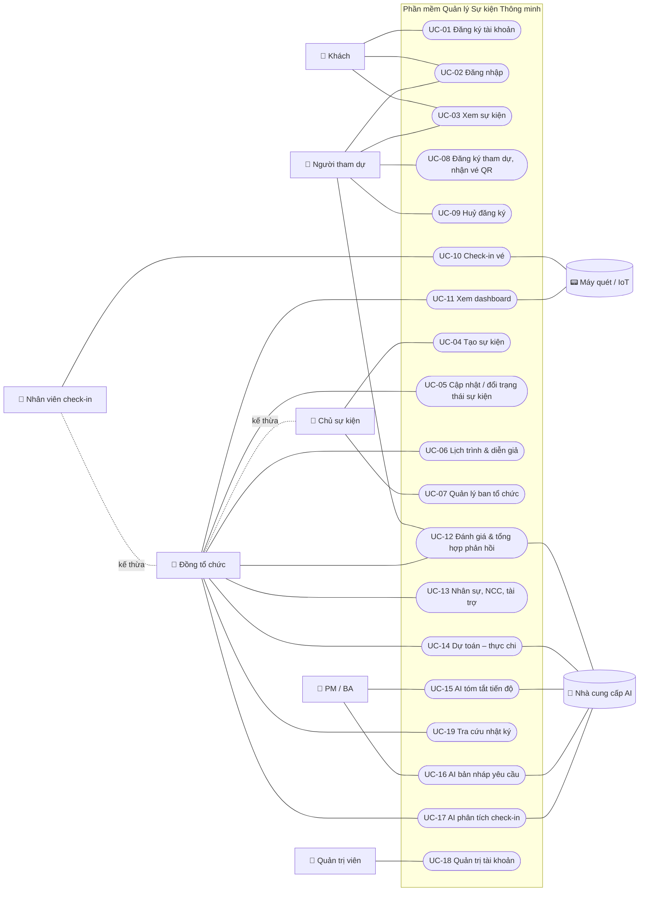

# Mô hình Use Case

> Người phụ trách: TV2 – BA. Đồng bộ với [SRS](../02-scope-and-requirements.md) (mã FR) và [API contract](api-contract.md).

## 1. Tác nhân

| Tác nhân | Mô tả | Quan hệ |
|---|---|---|
| Khách | Chưa đăng nhập | |
| Người tham dự | Tài khoản ATTENDEE | |
| Ban tổ chức | Tài khoản ORGANIZER | Tác nhân trừu tượng, tổng quát hoá của 3 vai trò dưới |
| Chủ sự kiện (OWNER) | Người tạo/được giao toàn quyền một sự kiện | Kế thừa Đồng tổ chức |
| Đồng tổ chức (CO_ORGANIZER) | Quản lý nội dung, nguồn lực, ngân sách, AI | Kế thừa Nhân viên check-in |
| Nhân viên check-in (CHECKIN_STAFF) | Chỉ quét vé | |
| Quản trị viên (ADMIN) | Quản lý tài khoản, được phép ở mọi sự kiện | |
| Thành viên dự án (PM, BA) | Người dùng nội bộ dùng AI hỗ trợ quản lý dự án | Trong hệ thống là tài khoản ORGANIZER |
| Nhà cung cấp AI (hệ thống ngoài) | Dịch vụ tương thích OpenAI Chat Completions | Tác nhân phụ |
| Máy quét / thiết bị IoT | Camera điện thoại, đầu đọc NFC, cảm biến | Tác nhân phụ |

## 2. Sơ đồ Use Case tổng quát

Ghi chú: Đồng tổ chức kế thừa quyền của Nhân viên check-in, Chủ sự kiện kế thừa quyền của Đồng tổ chức (ma trận quyền tại `apps/api/src/auth/event-access.ts`). Quản trị viên được phép thực hiện mọi use case ở mọi sự kiện. Mọi use case trừ UC-01, UC-02, UC-03 có quan hệ «include» với UC-02 Đăng nhập.

## 3. Danh mục Use Case

| ID | Use case | Tác nhân chính | FR | Trạng thái |
|---|---|---|---|---|
| UC-01 | Đăng ký tài khoản | Khách | FR-01 | Đã có |
| UC-02 | Đăng nhập | Mọi người dùng | FR-01 | Đã có |
| UC-03 | Xem danh sách, chi tiết sự kiện | Khách, Người tham dự | FR-02.4 | Đã có |
| UC-04 | Tạo sự kiện | Ban tổ chức (trở thành Chủ sự kiện) | FR-02.1 | Đã có |
| UC-05 | Cập nhật, công bố, kết thúc, huỷ sự kiện | Chủ sự kiện, Đồng tổ chức | FR-02.2–2.3 | Đã có |
| UC-06 | Quản lý lịch trình và diễn giả | Đồng tổ chức | FR-03 | Đã có |
| UC-07 | Quản lý thành viên ban tổ chức | Chủ sự kiện | FR-15 | Đã có |
| UC-08 | Đăng ký tham dự và nhận vé QR | Người tham dự (hoặc Đồng tổ chức đăng ký hộ) | FR-04, FR-05 | Đã có |
| UC-09 | Huỷ đăng ký | Người tham dự, Đồng tổ chức | FR-04.3 | Đã có |
| UC-10 | Check-in vé | Nhân viên check-in | FR-06 | Đã có |
| UC-11 | Xem dashboard sự kiện | Đồng tổ chức | FR-07, FR-17 | Đã có |
| UC-12 | Gửi đánh giá; tổng hợp phản hồi bằng AI | Người tham dự; Đồng tổ chức | FR-08, FR-14 | Một phần (thiếu gửi đánh giá) |
| UC-13 | Quản lý nhân sự, nhà cung cấp, nhà tài trợ | Đồng tổ chức | FR-09.1–9.3 | Đã có |
| UC-14 | Lập dự toán (có AI gợi ý), ghi thực chi | Đồng tổ chức | FR-09.4–9.5, FR-12 | Đã có |
| UC-15 | AI tóm tắt tiến độ dự án | PM | FR-10 | Đã có API |
| UC-16 | AI tạo bản nháp yêu cầu | BA | FR-11 | Đã có API |
| UC-17 | AI phân tích log check-in | Đồng tổ chức | FR-13 | Đã có |
| UC-18 | Quản trị tài khoản, đổi quyền | Quản trị viên | FR-01.4 | Đã có |
| UC-19 | Tra cứu nhật ký thao tác | Đồng tổ chức | FR-16 | Một phần (chưa có màn hình) |

## 4. Đặc tả chi tiết các Use Case chính

### UC-04. Tạo sự kiện

| Mục | Nội dung |
|---|---|
| Tác nhân chính | Ban tổ chức (ORGANIZER) |
| Mục tiêu | Tạo một sự kiện ở trạng thái nháp để chuẩn bị nội dung trước khi công bố |
| Tiền điều kiện | Đã đăng nhập với quyền ORGANIZER hoặc ADMIN |
| Hậu điều kiện thành công | Sự kiện ở trạng thái DRAFT; người tạo là Chủ sự kiện (EventMember OWNER) trong cùng một giao dịch; ghi nhật ký thao tác |
| Kích hoạt | Bấm "+ Tạo sự kiện" trên trang Sự kiện |

**Luồng chính**

1. Hệ thống hiển thị form: tên, mô tả, địa điểm, thời gian bắt đầu, thời gian kết thúc, sức chứa.
2. Ban tổ chức nhập thông tin và bấm Tạo.
3. Hệ thống kiểm tra dữ liệu ngay trên form (bắt buộc, không ở quá khứ, kết thúc sau bắt đầu, sức chứa nguyên dương).
4. Hệ thống gửi `POST /api/events`; server kiểm tra lại và lưu sự kiện DRAFT, gán người tạo làm OWNER.
5. Hệ thống chuyển sang trang Thành viên ban tổ chức với thông báo "Đã tạo sự kiện" để mời thêm người (tiếp UC-07).

**Luồng thay thế / ngoại lệ**

- 3a. Dữ liệu sai: hiển thị lỗi tại từng ô, không gửi lên server.
- 4a. Server từ chối (400): hiển thị thông báo lỗi trả về, giữ nguyên dữ liệu đã nhập.
- 4b. Phiên đăng nhập hết hạn (401): chuyển về trang đăng nhập, quay lại form sau khi đăng nhập.

**Quy tắc:** BR-02 (sức chứa), FR-02.1.

### UC-08. Đăng ký tham dự và nhận vé QR

| Mục | Nội dung |
|---|---|
| Tác nhân chính | Người tham dự |
| Tác nhân phụ | Đồng tổ chức (đăng ký hộ) |
| Tiền điều kiện | Đã đăng nhập; sự kiện PUBLISHED, chưa bắt đầu |
| Hậu điều kiện thành công | Có đăng ký CONFIRMED và một vé với mã QR có chữ ký; số chỗ còn lại giảm 1; ghi nhật ký |
| Kích hoạt | Bấm "Đăng ký" ở trang chi tiết sự kiện |

**Luồng chính**

1. Người tham dự mở chi tiết sự kiện (UC-03), xem lịch trình, diễn giả, số chỗ còn lại.
2. Bấm Đăng ký.
3. Hệ thống (trong giao dịch tuần tự hoá) kiểm tra: sự kiện PUBLISHED, chưa bắt đầu, người dùng chưa có đăng ký còn hiệu lực, còn chỗ.
4. Hệ thống tạo đăng ký CONFIRMED và vé, ký mã QR `SE1.<ticketId>.<HMAC>`.
5. Hệ thống hiển thị thành công; vé xuất hiện ở trang "Vé của tôi" dưới dạng mã QR.

**Luồng thay thế / ngoại lệ**

- 3a. Đã đăng ký trước đó → 409 "Người dùng đã đăng ký sự kiện này".
- 3b. Hết chỗ → 409 "Sự kiện đã đủ sức chứa".
- 3c. Sự kiện chưa mở đăng ký hoặc đã bắt đầu → 409, ẩn nút Đăng ký.
- 3d. Hai người cùng giành chỗ cuối → một người thành công, người kia nhận 409 "Có đăng ký đồng thời. Vui lòng thử lại".
- 3e. Từng huỷ đăng ký trước đó → kích hoạt lại đăng ký cũ thay vì tạo mới.
- 2a. Đồng tổ chức đăng ký hộ: chọn người dùng; hệ thống kiểm tra người gọi có vai trò quản lý sự kiện.

**Quy tắc:** BR-01, BR-02, BR-03.

### UC-10. Check-in vé

| Mục | Nội dung |
|---|---|
| Tác nhân chính | Nhân viên check-in (hoặc Đồng tổ chức, Chủ sự kiện) |
| Tác nhân phụ | Máy quét (camera điện thoại, đầu đọc NFC) |
| Tiền điều kiện | Đã đăng nhập; là thành viên ban tổ chức của sự kiện; đã chọn sự kiện trên màn Check-in |
| Hậu điều kiện | Luôn ghi một CheckInAttempt (kết quả, máy quét, người vận hành, thời điểm). Nếu ACCEPTED: `Ticket.checkedInAt` được đặt |
| Kích hoạt | Người tham dự đưa mã QR vào camera hoặc chạm thẻ NFC |

**Luồng chính**

1. Nhân viên mở màn Check-in, bật camera.
2. Máy quét đọc nội dung QR và gửi `POST /api/check-in { eventId, code, method, deviceCode }`.
3. Hệ thống xác thực chữ ký mã, tìm vé, kiểm tra vé thuộc sự kiện, đăng ký CONFIRMED, chưa check-in, đang trong khung giờ check-in.
4. Hệ thống đánh dấu vé đã check-in bằng cập nhật có điều kiện (`checkedInAt IS NULL`).
5. Hệ thống trả ACCEPTED kèm tên người tham dự; màn hình hiện lớp phủ **xanh**, rung ngắn.

**Luồng thay thế / ngoại lệ** (mọi trường hợp đều ghi lượt quét)

| Điều kiện | Kết quả | Màn hình |
|---|---|---|
| Mã sai chữ ký / không tồn tại | INVALID_CODE | Đỏ |
| Vé của sự kiện khác | WRONG_EVENT | Đỏ |
| Đăng ký đã huỷ / chưa xác nhận | NOT_ELIGIBLE | Đỏ |
| Vé đã check-in (kể cả máy khác vừa quét cùng lúc) | DUPLICATE | Cam, hiện thời điểm check-in trước |
| Trước giờ mở cổng hoặc sau khi sự kiện kết thúc | OUT_OF_HOURS | Cam, hiện giờ mở/đóng cổng |
| Không quét được | Nhập mã thủ công (method = MANUAL) | |

**Quy tắc:** BR-05, BR-06. **NFR:** NFR-REL-01, NFR-USA-02.

### UC-14. Lập dự toán (có AI gợi ý) và ghi thực chi

| Mục | Nội dung |
|---|---|
| Tác nhân chính | Đồng tổ chức |
| Tác nhân phụ | Nhà cung cấp AI |
| Tiền điều kiện | Là OWNER/CO_ORGANIZER của sự kiện |
| Hậu điều kiện | Các dòng dự toán/thực chi được lưu; tổng hợp dự toán – thực chi cập nhật trên dashboard |

**Luồng chính**

1. Mở trang Nguồn lực → tab Dự toán – thực chi, chọn sự kiện.
2. Thêm dòng dự toán: nhóm, tên, số lượng, đơn vị, đơn giá, nhà cung cấp (tuỳ chọn). Hệ thống tính thành tiền.
3. Khi phát sinh chi, thêm khoản thực chi gắn với dòng dự toán (hoặc để trống nếu là chi ngoài dự toán), số hoá đơn, ngày chi.
4. Hệ thống hiển thị chênh lệch theo từng nhóm và tổng (`GET /resources/budget-summary/:eventId`).

**Luồng mở rộng – AI gợi ý dự toán (FR-12)**

- 2a. Nhập loại sự kiện, số người, số ngày, địa điểm, ràng buộc, tiền tệ → `POST /ai/budget-estimate`.
- 2b. AI trả danh sách khoản mục; **server tính lại** thành tiền và tổng, kèm giả định và khoản loại trừ.
- 2c. Đồng tổ chức rà soát; chỉ những dòng được chấp nhận mới lưu với `source = AI_SUGGESTED` và người duyệt. *(Chưa làm: hiện chưa có giao diện gọi AI dự toán và API chưa ghi người duyệt; Đồng tổ chức nhập tay các dòng đã chọn.)*

**Ngoại lệ:** AI chưa cấu hình → 503; AI trả số không hợp lệ → 502, không lưu gì.

### UC-16. AI tạo bản nháp yêu cầu (FR-11)

| Mục | Nội dung |
|---|---|
| Tác nhân chính | BA (tài khoản ORGANIZER) |
| Tác nhân phụ | Nhà cung cấp AI |
| Mục tiêu | Rút ngắn thời gian chuyển ghi chép khảo sát thành yêu cầu có cấu trúc, nhưng giữ BA là người quyết định |
| Tiền điều kiện | Đã cấu hình `AI_API_KEY`; BA có mô tả nghiệp vụ từ khảo sát/phỏng vấn |
| Hậu điều kiện | Nhận bản nháp trạng thái `DRAFT_PENDING_BA_REVIEW`; **không** tự ghi vào SRS |

**Luồng chính**

1. BA gửi `POST /api/ai/requirements-draft` với mô tả nghiệp vụ, nhóm người dùng và (tuỳ chọn) module, mục tiêu, ràng buộc, số yêu cầu tối đa.
2. Hệ thống che email, số điện thoại, số CMND/CCCD trong đầu vào.
3. Hệ thống gửi cho AI: đầu vào đã che + danh mục yêu cầu đã chốt (FR-01…FR-17) để AI không viết lại yêu cầu cũ.
4. AI trả JSON: FR kèm tiêu chí chấp nhận, NFR kèm chỉ số, use case, quy tắc nghiệp vụ, rủi ro, giả định, câu hỏi làm rõ.
5. Hệ thống hậu kiểm: cấp mã nháp `DRAFT-FR-xx`, chuẩn hoá ưu tiên MoSCoW, phát hiện từ mơ hồ, thiếu tiêu chí chấp nhận, trùng SRS, yêu cầu AI thiếu bước con người duyệt, NFR không đo được, use case tham chiếu sai; dựng ma trận truy vết; tính điểm chất lượng.
6. Hệ thống trả bản nháp, danh sách phát hiện, checklist rà soát và đoạn Markdown.
7. BA xử lý phát hiện mức error, hỏi lại bên liên quan các câu hỏi làm rõ, rồi mới cấp mã chính thức và đưa vào SRS.

**Ngoại lệ:** đầu vào quá dài/sai kiểu → 400; AI chưa cấu hình → 503; AI lỗi hoặc trả JSON hỏng → 502; AI trả dữ liệu thiếu → vẫn trả bản nháp với phát hiện `NO_FUNCTIONAL_REQUIREMENTS`, `readiness = NEEDS_REWORK`.

### UC-17. AI phân tích log check-in (FR-13)

| Mục | Nội dung |
|---|---|
| Tác nhân chính | Đồng tổ chức |
| Tiền điều kiện | Sự kiện có lượt quét trong khoảng thời gian chọn |
| Hậu điều kiện | Nhận danh sách vé cần rà soát kèm bằng chứng; không vé nào bị khoá tự động |

**Luồng chính**

1. Trên màn Check-in, mở bảng "Kiểm tra gian lận", chọn khoảng thời gian (`from`, `to` ≤ 30 ngày).
2. Hệ thống lấy thống kê và lịch sử quét từng vé trong khoảng, gửi AI kèm 4 luật cố định (R1 quét lặp dồn dập, R2 lặp kéo dài, R3 nhiều cụm tách biệt, R4 nhiều lượt ACCEPTED gần đồng thời ở máy khác nhau).
3. AI đánh giá từng vé; backend chỉ kết luận `isFraud: true` khi AI nghi ngờ đủ ngưỡng **và** log khớp ít nhất một luật.
4. Hệ thống hiển thị mức rủi ro, các tín hiệu, kết luận theo vé, bằng chứng từng lượt quét và khuyến nghị.
5. Đồng tổ chức đối chiếu thực tế tại cổng rồi tự quyết định xử lý.

**Ngoại lệ:** `from > to` hoặc quá 30 ngày → 400; AI quá 10 giây hoặc trả 503 → backend trả **kết quả mẫu cố định** (`generatedBy: "timeout-fallback-static"`) chỉ dành cho demo. Kết quả này không phản ánh dữ liệu sự kiện đang chọn, giao diện phải ghi rõ (xem rủi ro R-14).

## 5. Đặc tả rút gọn các Use Case còn lại

| ID | Luồng chính rút gọn | Ngoại lệ chính |
|---|---|---|
| UC-01 | Nhập email, họ tên, mật khẩu → tạo tài khoản ATTENDEE → đăng nhập luôn | Email trùng (409); mật khẩu < 8 ký tự (400) |
| UC-02 | Nhập email/mật khẩu → nhận token → về trang chủ theo vai trò | Sai thông tin (401, thông báo chung) |
| UC-03 | Xem danh sách sự kiện đã công bố → mở chi tiết (mô tả, lịch trình, diễn giả, chỗ còn lại) | Bản nháp không hiện với khách |
| UC-05 | Sửa thông tin; bấm Công bố / Về nháp / Kết thúc / Huỷ | Chuyển trạng thái sai vòng đời (400); Đồng tổ chức bấm Huỷ (403) |
| UC-06 | Thêm phiên (giờ, phòng, diễn giả), thêm diễn giả | Phiên ngoài thời gian sự kiện (400) |
| UC-07 | Thêm thành viên theo email + vai trò; đổi vai trò; gỡ | Email chưa có quyền ORGANIZER (400); gỡ OWNER cuối cùng (400) |
| UC-09 | Bấm Huỷ ở "Vé của tôi" → đăng ký CANCELLED, vé hết hiệu lực | Vé đã check-in (409) |
| UC-11 | Chọn sự kiện → xem KPI, biểu đồ đăng ký, check-in, kết quả quét, mật độ khu vực, dự toán – thực chi | Không có quyền (403) |
| UC-12 | Người tham dự gửi điểm + nhận xét; Đồng tổ chức bấm "Tổng hợp phản hồi" → AI trả chủ đề tích cực/cần cải thiện, gợi ý hành động | Chưa có đánh giá (400); phần gửi đánh giá chưa làm |
| UC-13 | CRUD nhân sự, phân công theo ca; CRUD nhà cung cấp; CRUD nhà tài trợ theo sự kiện | Phân công trùng vai trò (409) |
| UC-15 | PM nhập kỳ báo cáo, việc xong, việc tồn, rủi ro → AI trả tóm tắt, vướng mắc, hành động tiếp theo | AI chưa cấu hình (503) |
| UC-18 | ADMIN xem danh sách tài khoản, đổi quyền | Không phải ADMIN (403) |
| UC-19 | Lọc nhật ký theo sự kiện, khoảng thời gian, phân trang | Không có quyền (403) |
